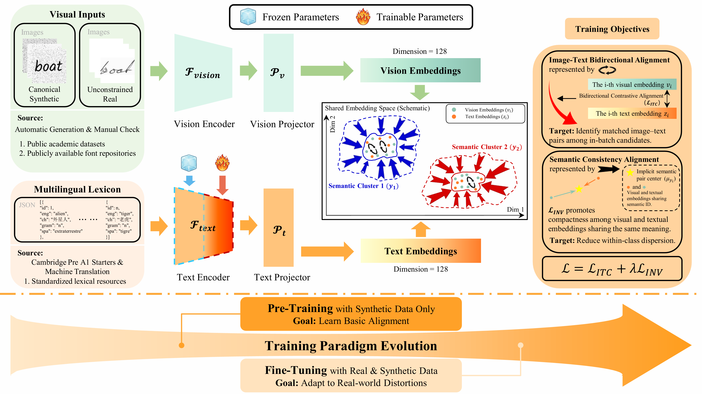

<div align="center">
  <h2><b>Lightweight Semantic Anchoring for Fixed-Lexicon Cross-Script Handwritten Word Retrieval</b></h2>
</div>

## Overview
This is the official implementation of the core architecture presented in the paper "Lightweight Semantic Anchoring for Fixed-Lexicon Cross-Script Handwritten Word Retrieval," provided to facilitate reproducibility during the peer-review process.

This repository contains the core source code, further details on baseline-adapted training, and relevant licensing information. Upon acceptance, we will publicly release the full implementation, including the trained model weights and the code for data preprocessing and dataset construction.

<p align="center">
   
</p>

## How to use

Run the commands below from the directory containing `pretrain.py` and `finetune.py`.

### 1. Install dependencies

```bash
python -m pip install -r requirements.txt
```

Both scripts load the public `distilbert-base-multilingual-cased` tokenizer and text backbone. Make them available through Hugging Face or its local cache before training.

### 2. Prepare the inputs

Use one JSON lexicon shared by both stages. Each record has an integer semantic ID and three lexical forms. For example, one record in the JSON array could be

```json
[
  {"id": 0, "eng": "apple", "ch": "苹果", "spa": "manzana"}
]
```

Under each image root, use the path `<language>/<semantic-id>/<image-file>`, for example `eng/0/sample.png`. The loader recognizes `eng`, `ch`, and `spa` directories and files ending in `.png`, `.jpg`, or `.jpeg`. The study uses 292 lexicon entries. For a smaller collection, use at least five entries for ACC@5 and set each training batch size no higher than the number of distinct semantic IDs in that stage's training data.

### 3. Train on synthetic word images

In the `CONFIG` dictionary in `pretrain.py`, set `train_data_root` to the synthetic training images, `test_data_root` to the held-out validation images, and `json_path` to the lexicon file. Then run

```bash
python pretrain.py
```

The visual backbone and projection heads start from random weights. After each epoch, the script switches to evaluation mode, rebuilds the English lexicon index, and evaluates retrieval. It saves the checkpoint with the highest validation ACC@1 to `./checkpoints/best_model.pth` by default.

### 4. Fine-tune on real and synthetic word images

In `finetune.py`, set the following `CONFIG` entries.

| Entry | Value |
| --- | --- |
| `pretrained_ckpt` | Stage-one checkpoint, by default `./checkpoints/best_model.pth` |
| `json_path` | The same lexicon JSON file |
| `real_train_root`, `synth_train_root` | Real and synthetic training image roots, respectively |
| `in_domain_test_root`, `ood_test_root` | Independent in-domain and out-of-domain validation image roots, respectively |

```bash
python finetune.py
```

Stage two combines the real training set with up to 20,000 sampled synthetic images. Each epoch, the script rebuilds the English index in evaluation mode and reports ACC@1 and ACC@5 for both validation splits. It saves per-epoch checkpoints and selects `./checkpoints/finetune_mixed/best_finetuned_model.pth` by out-of-domain validation ACC@1.

## Baseline adaptation protocols

We evaluate seven pretrained configurations across four families using both their released and task-adapted checkpoints. For adaptation, all four families use AdamW and the same two-stage training corpus as our framework. The synthetic stage runs for up to two epochs and the mixed stage for up to six, with early stopping and checkpoint selection based on validation retrieval performance.

- **SigLIP 2 (So400m/Giant).** We insert LoRA adapters ($r=32$) into the attention and feed-forward projections of both towers. We jointly train the adapters, the visual pooling head, the text output head, and the logit scale and bias, while freezing the remaining pretrained parameters. We use a sigmoid contrastive objective with positives defined by matching semantic IDs.

- **GME-Qwen2VL (2B/7B).** We apply LoRA ($r=32$) to the visual encoder and language decoder and fully update the visual merger, retaining the native pooling, embedding dimensionality, and normalization. Training uses image-to-text InfoNCE with $\tau=0.03$ and a global contrastive batch of 256 pairs implemented through GradCache.

- **VLM2Vec-V2 (Qwen2-VL-2B).** We initialize Qwen2-VL-2B-Instruct with the released VLM2Vec-V2 DoRA adapter ($r=16$) and continue updating the adapter parameters in the decoder's attention projections and feed-forward down-projections. We freeze the visual encoder, the visual merger, and the remaining pretrained parameters. We retain the original pooling and $\ell_2$ normalization and train with image-to-text InfoNCE ($\tau=0.02$) using task-specific cross-lingual positive pairs. 

- **UniME-V2 (2B/7B).** Starting from the released weights, we add DoRA adapters ($r=16$) to the language decoder's attention projections and feed-forward down-projections. We freeze the visual encoder, the visual merger, and the remaining pretrained parameters. For each training query, a frozen Qwen2.5-VL-7B-Instruct teacher scores one positive and eight hard negatives from the target-language lexicon offline. We train the student to match the teacher's distribution over these nine candidates using symmetric KL divergence with $\tau=0.02$.

For **PHOCNet**, We train the author-linked PyTorch implementation from scratch, retaining its convolutional, spatial pyramid pooling, and fully connected structure while extending the output to Chinese, English, and Spanish PHOC heads with 5,224, 604, and 702 attributes, respectively. For each image, a randomly selected target-language head is supervised by the corresponding semantic category's PHOC code using mean binary cross-entropy over attributes; retrieval compares the predicted attributes with target-language lexicon codes by cosine similarity.


## Contact

If you have any questions regarding this study, please feel free to contact:

- Fangke Chen: [fkchen@zju.edu.cn](mailto:fkchen@zju.edu.cn)

## License

This project is released under the [MIT License](LICENSE).


